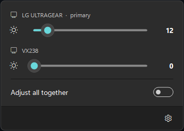
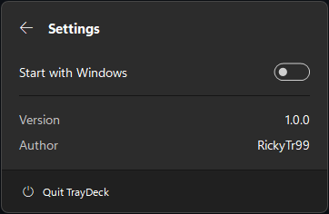
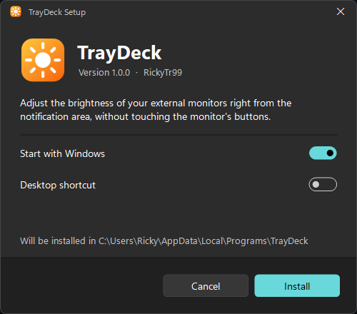

# TrayDeck

Adjust the brightness of your external monitors right from the Windows notification area, without touching the buttons or joystick on the monitor.

<p>
  
  
</p>

## Features

- One slider for each connected monitor, labelled with the model name reported by the monitor
- **Adjust all together**: a single slider drives every monitor
- Windows 11 look and feel that follows your system's accent color and light/dark theme
- Optional start with Windows
- Guided installer, no administrator rights required
- English and Italian interface, picked automatically from your Windows language

## How it works

TrayDeck uses **DDC/CI**, the protocol a PC can use to send commands to a monitor through the video cable (HDMI or DisplayPort). It's the same channel the monitor's own buttons control, so the change happens in the actual backlight, not through a software filter.

## Requirements

- Windows 10 or 11 (the design targets Windows 11)
- An external monitor with **DDC/CI enabled**: it's usually an option in the monitor's on-screen menu, and it's often on by default
- .NET Framework 4.x, already included in Windows

### Known limitations

- **Laptop screens** don't use DDC/CI, so they don't appear in the panel.
- **Docks, USB-C hubs, DisplayLink adapters and KVM switches** often don't pass DDC/CI through. The monitor still works, but its slider shows *n/a*. Connecting it directly to the graphics card usually fixes this.
- **TVs** almost never support DDC/CI.
- Some monitors lock brightness in certain modes (HDR, for example).

## Installation



1. Download `TrayDeck-Setup.exe` from the [Releases](../../releases) page
2. Run it and follow the guided setup: you can choose whether TrayDeck starts with Windows and whether to add a desktop shortcut
3. The sun icon appears in the notification area (if you don't see it, look under the **^** arrow)

TrayDeck installs for the current user only, in `%LocalAppData%\Programs\TrayDeck`, without asking for administrator rights. You'll find it in the Start menu, and you can uninstall it from **Settings → Apps → Installed apps**.

Windows may show a SmartScreen warning because the installer isn't signed: choose *More info* → *Run anyway*.

## Usage

| Action | Result |
| --- | --- |
| Left-click the tray icon | Opens or closes the panel |
| Right-click the tray icon | Shows the menu to quit TrayDeck |
| Drag a slider | Changes the brightness |
| Mouse wheel over a slider | ±5 |
| Arrows / Page Up / Page Down / Home / End | ±1 / ±10 / minimum / maximum |
| Esc | Closes the panel (or goes back from Settings) |

## Building from source

You don't need Visual Studio: the C# compiler that ships with Windows is enough.

```cmd
build.cmd
```

This creates `bin\TrayDeck-Setup.exe`. The installer and the app are the same executable: run from anywhere it shows the setup, which copies itself to the install folder as `TrayDeck.exe`; run from there, it's the tray app.

| Path | Contents |
| --- | --- |
| `src/Entry.cs` | Entry point: decides between setup, app and uninstall |
| `src/TrayDeck.cs` | The app: panel, sliders and DDC/CI communication |
| `src/Setup.cs` | Guided install and uninstall |
| `src/Shared.cs` | Windows 11 theme, shared controls and translations |
| `assets/app.ico` | App icon, generated by `tools/make-icon.ps1` |

For development:

- `TrayDeck-Setup.exe --app` runs the tray app without installing it
- `TRAYDECK_LANG=en` or `TRAYDECK_LANG=it` forces the interface language

## License

[MIT](LICENSE) © RickyTr99
